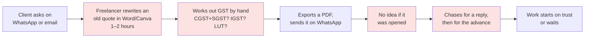
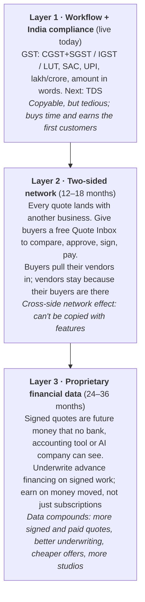
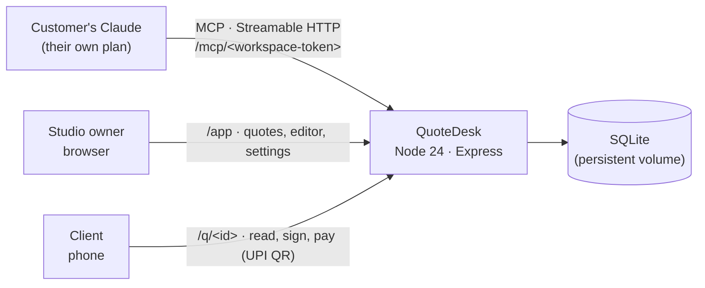

# QuoteDesk: product document

**Claude writes the quotation. Your client signs it on their phone and pays the advance by UPI.**

Live app: https://quotedesk-production-73fe6b63.up.railway.app · Back to the [overview](README.md)

> The source code lives in a private repository. Section 15 describes how it is built and tested.

---

## Contents
1. [TL;DR](#1-tldr)
2. [Problem discovery](#2-problem-discovery)
3. [Problem framing](#3-problem-framing)
4. [Choosing the opportunity](#4-choosing-the-opportunity)
5. [Prioritisation: what's in the MVP and what isn't](#5-prioritisation-whats-in-the-mvp-and-what-isnt)
6. [The bets](#6-the-bets)
7. [The moat](#7-the-moat)
8. [PRD](#8-prd)
9. [Success metrics](#9-success-metrics)
10. [Business model and unit economics](#10-business-model-and-unit-economics)
11. [Go-to-market: the first 100 customers](#11-go-to-market-the-first-100-customers)
12. [Roadmap](#12-roadmap)
13. [Risks, assumptions and open questions](#13-risks-assumptions-and-open-questions)
14. [Decision log](#14-decision-log)
15. [How it's built and tested](#15-how-its-built-and-tested)

---

## 1. TL;DR

| | |
|---|---|
| **Who** | Indian freelancers and 2–20 person studios (design, development, marketing, video) who send 3–20 quotes a month and already use Claude. |
| **Problem** | Getting from "can you send me a quote?" to "advance received" is slow, manual and invisible. Quotes take 1–2 hours to write, GST is easy to get wrong, the PDF disappears into WhatsApp, and work starts before the advance arrives. |
| **Solution** | The customer's Claude drafts a GST-correct quote from the client's message. QuoteDesk stores it, lets a person edit it, and hosts it at a link the client signs on their phone. A UPI QR for the exact advance appears on signing, and every view, signature and payment is tracked. Claude can read the pipeline back ("who's gone quiet?"). |
| **Why it wins** | No AI cost, so it's profitable at ₹499/month. It's India-first (GST, TDS, LUT, UPI), and every quote reaches another business, which is the seed of a two-sided network. |
| **Status** | MVP live. All P0 requirements are built, and a 132-check end-to-end test passes against the live deployment. |

---

## 2. Problem discovery

### How the problem was found
I started from the assignment's constraint (Claude does the thinking; the app must stay live, serve real people and keep working after the chat ends) and looked for jobs with three properties:

1. **A writing-heavy first step** that Claude is genuinely good at.
2. **A second party** who must see, act on, or pay for the result. That is what makes a hosted app necessary, not optional.
3. **Money changing hands**, so customers will pay and the product can grow into payments, which is close to Volopay's world.

A freelancer's quote fits all three: Claude writes it, the client must open and sign it, and an advance follows. I then mapped the typical current workflow and marked every claim below as either evidence or an assumption still to test.

### The current journey and where it breaks

| Pain point | What it costs | Evidence today |
|---|---|---|
| Writing the quote | 1–2 hours per quote, usually after hours | Assumption (to quantify in interviews) |
| GST treatment | Wrong tax type means a reissued document and a delay. Export under LUT is widely misunderstood. | GST rules are well documented; how often people get them wrong is an assumption |
| No visibility | Follow-ups are guesswork, and warm leads go cold | Assumption |
| Late advance | Cash-flow strain; work starts unpaid or the start is delayed | Assumption (to quantify in interviews) |
| TDS (next) | Business clients deduct 10% TDS on professional fees, and freelancers chase the deduction certificates for months | Indian tax rule; how painful it is will be confirmed in interviews |

### Evidence vs. assumption
I'm being explicit here: **the pain follows from how quoting typically works today, but its size is not yet measured.** The validation plan (section 13) runs before any further building:

- **10 interviews** with studio founders: walk through their last 3 quotes (time spent, tool used, days to signature, days to advance).
- **20 hands-on onboardings**, each sending a real quote to a real client.
- **10 interviews on the buyer side** (cafés, clinics, D2C brands) about how they receive, compare and approve vendor quotes. This tests the network bet in section 6.

---

## 3. Problem framing

### Problem statement
> **Indian freelancers and small studios lose hours on every quotation and wait too long for the advance, because the quote lives in a PDF on WhatsApp that nobody tracks.**

### Job to be done
> *When a client asks for a quote, I want to send a professional, correct quote the same day and know the moment they accept, so I can start work with the advance already in my account.*

### Who it's for

| Segment | Size of job | Quotes / month | Pain | Priority |
|---|---|---|---|---|
| **GST-registered studios, 2–20 people** | ₹50k–₹10L | 5–20 | High: GST, advances, several clients at once | **Primary (beachhead)** |
| Solo freelancers with clients abroad | ₹20k–₹3L, often in USD | 3–10 | High: export under LUT, SWIFT details | Primary |
| Solo freelancers, not GST-registered | ₹5k–₹50k | 2–8 | Medium | Secondary (free plan) |
| Agencies above 20 people | Retainers, ₹10L+ | 20+ | Need approval chains and CRM links | Not now |

**Primary persona: Aditi, studio founder (Bengaluru, 6 people).** Gets leads on WhatsApp and Instagram, and a third of her clients are outside Karnataka. She writes quotes at night from an old Google Doc and already uses Claude daily. She wants to quote the same day, know when the client has opened it, and start only once the advance is in.

### Why now
- Freelancers and studio owners already pay for Claude and use it for writing every day.
- **MCP** lets an app add actions to the customer's own Claude, so a product can be AI-powered without paying for AI.
- **UPI** is the default way Indian businesses move money, and a UPI QR code needs no payment gateway.

### Why not just use Claude?

| Need | Claude alone | QuoteDesk |
|---|---|---|
| Write the scope, pricing and cover note | ✅ | Uses Claude for it |
| Correct GST treatment and layout | Sometimes | ✅ The tool descriptions teach Claude the rules, and the server does the arithmetic |
| A link the client opens on their phone | ❌ | ✅ |
| Client signs; the quote locks | ❌ | ✅ |
| UPI QR for the exact advance | ❌ | ✅ |
| Knows it was opened three times | ❌ | ✅ |
| Remembers who owes you next week | ❌ | ✅ (Claude reads it back through `list_quotes`) |

---

## 4. Choosing the opportunity

The assignment rules out website builders and online shops. I scored the alternatives I considered on the criteria from section 2:

| Opportunity | Claude does real work | Second party must act | Money flows | Defensibility | Fit with Volopay | Verdict |
|---|---|---|---|---|---|---|
| **Quotes → signature → advance, Indian freelancers and studios** | High | High (client signs and pays) | High | Network + payments | High (vendor side of business spend) | ✅ **Chosen** |
| Same idea, global freelancers | High | High | High | Low (crowded: PandaDoc, Bonsai) | Medium | Too crowded, no wedge |
| Estimates for home contractors | High (photos → estimate) | High | High | Medium | Low | Harder to reach, less digital |
| Packages for event and wedding vendors | Medium | High | High | Low | Low | Seasonal, emotional sale |
| Expense reports from receipt photos | High | Medium | Medium | Low | **Overlaps Volopay's core product** | Avoided |
| Event pages and RSVPs | Medium | High | Low | Low | Low | Hard to monetise |

**Why the India focus:** it turns a crowded global category into a defensible niche. GST, TDS, export under LUT, UPI and lakh/crore formatting are real work that global tools treat as an afterthought.

---

## 5. Prioritisation: what's in the MVP and what isn't

**Rule:** build the smallest thing that completes **one full loop**, client message → Claude draft → human edit → client signature → advance → Claude reads it back, and do it properly instead of half-building many things.

### RICE scoring of candidate features
Reach = studios affected per quarter (estimate) · Impact 0.5–3 · Confidence % · Effort in person-weeks. Score = R × I × C ÷ E.

| Feature | Reach | Impact | Confidence | Effort | RICE | Decision |
|---|---|---|---|---|---|---|
| Claude drafts the quote via MCP (create/update/list/get) | 100 | 3 | 90% | 1 | **270** | ✅ MVP |
| Correct GST (CGST+SGST / IGST / LUT), SAC, amount in words | 100 | 3 | 80% | 1 | **240** | ✅ MVP |
| Hosted client page + typed signature + lock on signing | 100 | 3 | 70% | 1 | **210** | ✅ MVP |
| UPI QR for the advance on signing | 80 | 2 | 70% | 0.5 | **224** | ✅ MVP |
| Ledger with view tracking and live refresh | 100 | 2 | 80% | 1 | **160** | ✅ MVP |
| Editor with autosave and activity log | 100 | 2 | 90% | 1 | **180** | ✅ MVP |
| Owner alerts on open/sign (email or WhatsApp) | 100 | 1 | 80% | 1 | 80 | ⏭ Next |
| Payment gateway with automatic reconciliation | 80 | 2 | 50% | 3 | 27 | ⏭ Next (KYC, fees) |
| GST tax invoice from a signed quote | 70 | 2 | 60% | 2 | 42 | ⏭ Next |
| TDS handling on quotes and invoices | 60 | 2 | 50% | 2 | 30 | ⏭ Next |
| OTP / Aadhaar e-signature | 40 | 1 | 50% | 2 | 10 | ⏭ Later |
| Buyer Quote Inbox (network) | 50 | 3 | 30% | 4 | 11 | 🔬 Validate first, then build (see bets) |
| Team seats | 20 | 1 | 70% | 2 | 7 | ⏭ Later |

### Deliberately cut from the MVP, and why
- **No payment gateway.** A UPI QR proves the "pay on signing" behaviour without KYC, fees or weeks of integration.
- **No notifications.** The live ledger and Claude's read-back cover this for the first users.
- **No templates or rate cards.** Claude's drafting replaces templates at this stage.
- **No AI inside, by design.** Every judgement call (scope, price, GST treatment) is Claude's job; every record is ours.

### Product principles (the tie-breakers)
1. **Claude writes, QuoteDesk keeps the record.** No AI in our code.
2. **A person always has the last word.** Nothing reaches a client until the owner sends it.
3. **The client's experience is the product.** No sign-up, signing in under a minute on a phone.
4. **Correct before clever.** Totals are computed on the server, and a signed quote can never change.

---

## 6. The bets

Each bet states what must be true, how we'll know, and what would make us change course.

| # | Bet | What must be true | Signal it's working | Kill or pivot signal |
|---|---|---|---|---|
| **B1** | **Small businesses will run work through the AI they already use**, and the winners will plug into it rather than compete with it. | Target studios use Claude weekly and will connect a tool to it. | 6 of 10 interviewees use Claude weekly; 40% of sign-ups connect Claude within 7 days. | Under 3 of 10 use Claude. Then lead with a built-in form and treat Claude as a bonus. |
| **B2** | **The quote is the wedge.** Owning the first document of every job earns the advance, the invoice and the payment that follow. | Studios send most quotes through QuoteDesk once they start. | Over 70% of a studio's quotes go through QuoteDesk by month 2. | Studios use it once and go back to PDFs. |
| **B3** | **Clients will sign a link instead of replying "ok" on WhatsApp.** | Signing on a phone feels easier than replying. | 35%+ of sent quotes are signed through the link. | Under 15%. Then lead with tracking and the advance, and make signing optional. |
| **B4** | **A UPI QR at the moment of signing speeds up the advance.** | Clients are most willing to pay right after committing. | Median days from signature to advance falls against the studio's own history. | No change. Then move the payment gateway and reminders earlier. |
| **B5** | **Buyers want an inbox for vendor quotes**, creating a two-sided network. | Businesses that buy services compare and approve quotes painfully today. | 5 of 10 buyer interviews describe the pain; 20% of clients who sign later create an inbox. | No pull from buyers. Then QuoteDesk stays a strong vendor-side tool, and the moat leans on payments and data. |
| **B6** | **No AI cost is a lasting price advantage.** | Customers keep paying for their own AI plan. | Gross margin stays above 95%. | AI assistants stop supporting third-party connectors (low likelihood; MCP is spreading across assistants). |

---

## 7. The moat

**Honest starting point:** the editor and the connector can be copied in a quarter. Being "Claude-native" alone is not a moat. The moat is built in three layers, each harder to copy than the last.

### Why each layer holds
- **Layer 1, compliance depth.** India-specific tax and payment work is unglamorous, so global tools deprioritise it. It wins the first studios; on its own it isn't the moat.
- **Layer 2, the network (the real moat).** Every quote QuoteDesk sends reaches a business owner, so distribution is built in. Once a café chain prefers receiving vendor quotes in its QuoteDesk inbox (side-by-side comparison, correct GST, one-click approval), it **asks its vendors to send that way**. Competitors can copy the editor but not thousands of buyers who expect quotes to arrive there.
- **Layer 3, data and money.** QuoteDesk sees both sides of a deal before any invoice exists: what was signed, by whom, and how reliably each client pays. That powers **"get your 50% advance today, we collect from the client"** (through a lending partner, not our own balance sheet). Revenue shifts from ₹499 subscriptions to a share of the money moving through.

### The Volopay connection
> **Volopay serves the buyer: company spend and vendor payments. QuoteDesk serves the vendor: getting the quote signed and the advance collected.**
>
> Connected, a vendor's QuoteDesk quote lands in a Volopay customer's approval flow, gets approved, and is paid through Volopay. QuoteDesk is the **supplier-side entry point** to Volopay's network.

### Defending the obvious questions
| Question | Answer |
|---|---|
| Why won't Claude or OpenAI build this? | They're horizontal platforms and want vertical connectors like this one. They won't handle Indian GST, TDS, UPI collections and vendor networks for freelancers. The connector is assistant-neutral: it works with any assistant that supports MCP. |
| Why won't Zoho or Refrens copy it? | They can copy features, not a network. Their products start after the deal (invoicing, accounting); QuoteDesk owns the moment before it, the signature, and serves both sides of it. |
| Network effects take years. What's real today? | Layer 1 is live. Layer 2 is cheap to start because every client page is already a buyer touchpoint. Layer 3 comes only once there's data, and only with a partner. |

---

## 8. PRD

### User stories
- **US1.** As a studio owner, I paste a client's message into Claude and get a complete, GST-correct quotation in QuoteDesk.
- **US2.** As a studio owner, I edit any part of it before sending.
- **US3.** As a studio owner, I send one link on WhatsApp or email.
- **US4.** As a client, I sign by typing my name, with no account.
- **US5.** As a client, I see exactly how much advance to pay and pay it by UPI or bank transfer.
- **US6.** As a studio owner, I see who opened, signed, declined or paid.
- **US7.** As a studio owner, I ask Claude "who's gone quiet?" and get follow-ups based on real status.
- **US8.** As a studio owner, I revise a quote through Claude ("bring it under 2 lakh") without starting over, including after a client declines.

### Functional requirements

| ID | Requirement | Stories | Priority | Status |
|---|---|---|---|---|
| F1 | MCP server with `get_business_profile`, `create_quote`, `update_quote`, `list_quotes`, `get_quote`, `update_business_profile`, `get_password_reset_link` | US1, US7, US8 | P0 | ✅ Live |
| F2 | Tool descriptions teach Claude the GST rules (same state → CGST+SGST, other state → IGST, abroad → LUT, unregistered → none) and SAC codes | US1 | P0 | ✅ Live |
| F3 | Private, rotatable connector URL per workspace | US1 | P0 | ✅ Live |
| F4 | Quotes dashboard: status, totals, GST, views; live refresh when Claude adds a quote | US6 | P0 | ✅ Live |
| F5 | Editor: client, cover note, line items with SAC, currency, GST, discount, advance, validity, terms; autosave | US2 | P0 | ✅ Live |
| F6 | Server-side maths: subtotal, discount, taxable value, CGST/SGST or IGST, total, advance, amount in words (Indian system) | US2, US5 | P0 | ✅ Live |
| F7 | Hosted client page, phone-friendly, printable to PDF | US3 | P0 | ✅ Live |
| F8 | Typed-name signature with consent; decline with a reason | US4 | P0 | ✅ Live |
| F9 | Signed quotes lock and can't be deleted; declined, expired or blank quotes can't be signed; the client signs the exact version they were shown; a revised declined quote reopens at the same link | US4, US8 | P0 | ✅ Live |
| F10 | UPI QR and deep link for the exact advance; advances above the ₹1 lakh UPI limit point the client to bank transfer; bank and SWIFT details | US5 | P0 | ✅ Live |
| F11 | View tracking that ignores link-preview bots and the owner's own browser, and an activity log (drafted by Claude, edited by whom, opened, signed, declined, paid) | US6, US7 | P0 | ✅ Live |
| F12 | Share via WhatsApp or email; mark as sent / advance received | US3, US6 | P0 | ✅ Live |
| F13 | Business profile: letterhead, GSTIN, state, UPI, bank, default advance and terms, each validated before saving | US1, US5 | P0 | ✅ Live |
| F14 | Owner alerts on open, sign and decline | US6 | P1 | Planned |
| F15 | Payment gateway with automatic advance reconciliation | US5 | P1 | Planned |
| F16 | GST tax invoice from a signed quote | US5 | P1 | Planned |
| F17 | TDS handling (10% on professional fees) | US5 | P1 | Planned |
| F18 | OTP verification and a signing certificate | US4 | P1 | Planned |
| F19 | Buyer Quote Inbox | — | P1 (after validation) | Validate first |
| F20 | Team seats; win/loss insights readable by Claude | US7 | P2 | Later |

### Non-functional requirements
- **No AI inside:** no AI SDKs or keys. Dependencies: `express`, `@modelcontextprotocol/sdk`, `zod`, `qrcode`.
- **Integrity:** totals computed on the server; signed quotes immutable and undeletable through both the app and MCP; the client signs the exact version they were shown; currencies checked against ISO 4217; negative, impossible and oversized amounts and dates rejected; GSTIN and UPI IDs validated.
- **Security:** scrypt password hashes (N=2^15, older hashes upgraded on login); passwords of 8+ characters that aren't common, numbers-only or based on the user's name or email; session and reset tokens stored only as SHA-256 hashes; sessions expire on the server after 30 days; HttpOnly session cookies; login throttling (also on the current-password check in Settings) with equal timing for unknown emails; password change signs out other devices; tenant isolation on every query, HTML escaped everywhere, client pages not indexed by search engines.
- **Reliability:** an error on one page returns an error page for that request; it never takes the server down for other customers.
- **Performance:** the client page loads in under 2 s on 4G; new quotes appear on the dashboard within 3 s.
- **Compliance:** follows GST quotation conventions; personal data handled in line with India's DPDP Act. A typed signature is an electronic record of acceptance (OTP is planned for stronger evidence).

---

## 9. Success metrics

**North star: quotes signed per week through QuoteDesk.** A signature is the moment both sides get value: the studio wins the work and the client commits. Advance collected (₹) is tracked alongside as the money view of the same moment.

| Stage | Metric | Definition | 90-day target |
|---|---|---|---|
| Activate | Activation | New workspaces that connect Claude **and** send a quote within 7 days | 40% |
| Draft | Claude share | Quotes created through MCP ÷ all quotes | 70% |
| Draft | Edit-before-send | Claude-drafted quotes edited by a person before sending | 30–70% (too low means nobody reviews; too high means the drafts are poor) |
| Send | Time to send | Median minutes from draft to sent | < 30 min |
| Client | Open rate | Sent quotes opened at least once | 85% |
| Client | Sign rate | Signed ÷ sent | 35% |
| Client | Time to sign | Median days from sent to signed | < 3 days |
| Paid | Advance rate | Advance received ÷ signed | 70% |
| Retain | Week-4 retention | Studios active in week 4 | 40% |
| Revenue | Free → paid | Upgrades within 60 days | 8% |
| Network | Buyer pull | Clients who sign and later create an inbox (once F19 ships) | 20% |

**Guardrails:** zero GST or total errors (each one is a P0 bug) · zero edits to signed quotes · MCP error rate under 1% · decline rate tracked alongside sign rate.

**Instrumentation:** every quote already stores its source (Claude or manual), view count, last viewed, signed, declined and paid times, and a per-quote activity log. Still to add: sign-up source, first MCP call time per workspace, and a weekly metrics query.

*Targets are starting hypotheses, reset after 4 weeks of real data.*

---

## 10. Business model and unit economics

| Plan | Price (excl. GST) | Includes |
|---|---|---|
| Free | ₹0 | 3 quotes a month, "Sent with QuoteDesk" footer (built-in acquisition) |
| **Pro** | **₹499/month** or ₹4,990/year | Unlimited quotes, own letterhead, no footer |
| Studio | ₹1,499/month | 5 seats, shared pipeline (with F20) |
| Later | % of money moved | Gateway collections (F15) and advance financing (moat layer 3) |

| Unit economics (assumptions to validate) | Value |
|---|---|
| Hosting cost per studio | < ₹2/month (one ~₹1,500/month server for 1,000+ studios) |
| AI cost per studio | **₹0**: the customer's own Claude does the writing |
| Gross margin | > 95% |
| Target CAC | < ₹1,500 (founder-led and community first) |
| Assumed monthly churn | 4% |
| Lifetime value | ≈ ₹12,000 (₹499 × ~25 months) |
| LTV : CAC | ≈ 8 : 1, payback in about 3 months |

---

## 11. Go-to-market: the first 100 customers

| Step | Channel | Action | Target |
|---|---|---|---|
| 1 | Personal network | Hand-onboard 20 studios; send their first real quote with them | 20 |
| 2 | Designer and developer communities | A 60-second demo (client message → signed quote → UPI QR) on LinkedIn, X, Discord and Telegram | 30 |
| 3 | Co-working spaces in Bengaluru and Pune | Demo sessions; a free month of Pro for members | 20 |
| 4 | Claude and MCP connector directories | Listing | 10 |
| 5 | The client page itself | The footer on free-plan quotes: every client is a business that may also send quotes | 20 |

**Conversion path:** 3 free quotes → the limit hits when work is flowing → Pro. Target: **100 activated, 25 paying in 90 days.**

---

## 12. Roadmap

| Phase | When | What ships | Gate to move on |
|---|---|---|---|
| **Now** | Weeks 0–4 | Launch; 10 studio + 10 buyer interviews; 20 onboardings; a 20-case GST accuracy test | 10 studios sending real quotes, 3 signed through QuoteDesk |
| **Next** | Months 2–4 | Alerts (F14), payment gateway (F15), GST invoices (F16), TDS (F17), OTP signing (F18), billing | 25 paying studios |
| **Later** | Months 5–12 | Buyer Quote Inbox (F19) if B5 validates; team seats; win/loss insights | 70%+ advance rate, churn under 4% |
| **Year 1** | | ~1,000 paying studios ≈ ₹5 lakh MRR | |
| **Year 3** | | The money layer for Indian freelancers: quote → advance → invoice → collection, advance financing with a partner, and a Volopay integration on the buyer side. ~15,000 paying studios plus revenue on money moved. | |

---

## 13. Risks, assumptions and open questions

| Risk or assumption | How it's tested | Mitigation if it fails |
|---|---|---|
| Target studios already use Claude (B1) | Interviews; activation rate | Add a built-in form so the signing and advance flow works without Claude |
| Clients will sign a link (B3) | Sign rate on the first 30 real quotes | Make signing optional; lead with tracking and the advance |
| Claude picks the wrong GST treatment | A 20-scenario test across same state, other state, abroad and unregistered | Partly done: when Claude leaves it out, the GST type is worked out in code from the two GSTINs, states and the currency. Next, check every quote Claude marks against that rule |
| A larger tool adds a Claude connector | Watch the market | Compete on the network and payments (section 7), not the editor |
| Typed signatures challenged in a dispute | Legal review | OTP verification and a signing certificate (F18) |

**Open questions**
- How many Indian freelancers and studios are GST-registered **and** use Claude today? A sourced figure is needed before quoting a market size.
- Should GST treatment be decided in code, rather than by Claude? Decide after the 20-case test.
- Which payment gateway (Razorpay or Cashfree), and can it run without per-studio KYC friction?
- Does the "Sent with QuoteDesk" footer help or hurt how credible the quote looks to the client?

---

## 14. Decision log

| Decision | Alternatives | Why |
|---|---|---|
| India-first freelancers and studios | Global freelancers, contractors, event vendors | Compliance depth is a wedge in a crowded category, and it sits close to Volopay's market |
| Start at the quote, not the invoice | Invoicing first | Invoicing is crowded (Zoho, Refrens); the quote comes first, sits closer to the deal, and is where AI writing helps most |
| No AI inside; all judgement goes to Claude via MCP | Our own LLM calls | Zero AI cost and the assignment's constraint; Claude is better at writing than anything we'd build |
| GST rules taught through tool descriptions; the server does the arithmetic | Claude computes totals | Claude handles the judgement (which tax applies); code handles correctness (the numbers) |
| UPI QR instead of a payment gateway | Razorpay from day one | Proves "pay on signing" without KYC, fees or integration time |
| Above ₹1 lakh, keep the UPI QR but lead with bank transfer | Hide the QR | Most personal UPI IDs cap one payment at ₹1 lakh, but some business UPI IDs allow more |
| Password reset through the workspace's own Claude connector | Email reset | No email provider yet; the connector URL already proves ownership of the workspace. Email reset comes with owner alerts (F14) |
| Typed signature with consent | OTP or Aadhaar e-sign | Lowest friction for the MVP; OTP planned for high-value work |
| Revising a declined quote reopens it at the same link | Force a new quote | Matches how negotiation actually goes; the client keeps one link |
| SQLite on a persistent volume | Postgres | One process, no extra service, more than enough for the first thousands of studios |
| Stateless MCP over Streamable HTTP with a per-workspace token in the URL | OAuth | Works with claude.ai custom connectors in 30 seconds; the token can be rotated at any time |

---

## 15. How it's built and tested

- **Stack:** Node 24 and Express, with SQLite through the built-in `node:sqlite`. **No AI SDKs or keys.**
- **MCP:** stateless server. Each workspace has a private connector URL that can be rotated at any time.
- **Security:** scrypt passwords with a strength policy, hashed session and reset tokens, 30-day server-side sessions, HttpOnly cookies, login throttling, tenant isolation, escaped output, versioned static assets.

### End-to-end test
An automated end-to-end test walks through **132 checks** as a new studio owner, their Claude and their clients:
- **Owner setup:** sign up, settings, connect.
- **Claude drafting:** three GST scenarios.
- **Owner editing:** edit and send.
- **Client actions:** view tracking, signing, UPI amount check, decline and revise.
- **Rules:** locking, expiry.
- **Security:** isolation between accounts, escaping.
- **Bad input:** rejected.
- **Integrity:** signed quotes can't be reverted or repriced, only the client can accept or decline, a stale editor can't overwrite Claude's edit, and the demo can't be broken by reviewers.
- **Edge cases from using the live app:** signing a version that changed after the client opened it, amounts at the ceiling, advances above the ₹1 lakh UPI limit, link-preview bots and the owner's own phone not counted as views, real dates and India-time expiry, settings validation, GST defaults, blank quotes.
- **Account controls:** weak-password rules, password change and reset through Claude, login throttling, connector rotation, logout.

Current result: **132 passed, 0 failed** against the live deployment.
