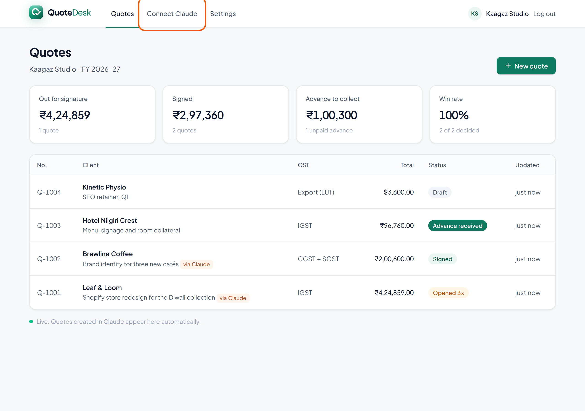
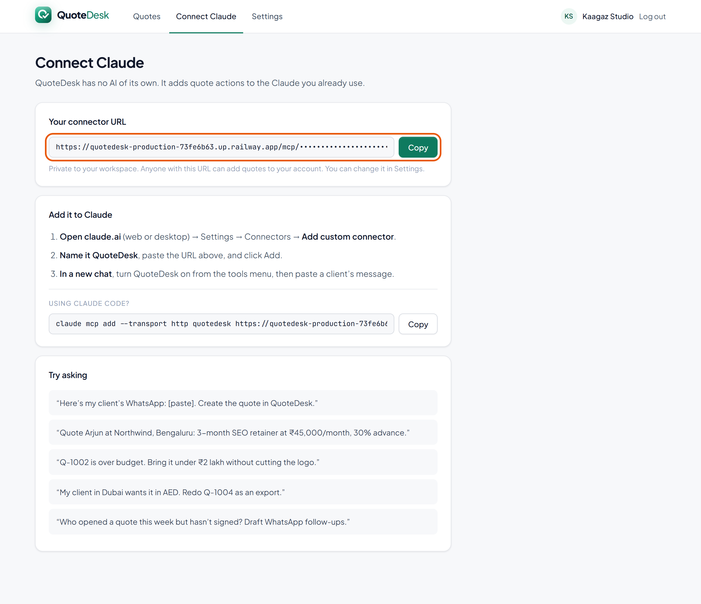

# QuoteDesk

**Claude writes the quotation. Your client signs it on their phone and pays the advance by UPI.**

QuoteDesk is a quotation tool for Indian freelancers and small studios. It works inside the Claude you already use, through an MCP connector, and has no AI of its own. Claude drafts a GST-correct quote from a plain-language brief. QuoteDesk sends it, shows you when the client opens it, collects their signature and shows them a UPI QR code for the advance.

| | |
|---|---|
| **Live app** | https://quotedesk-production-73fe6b63.up.railway.app |
| **Sample signed quote (client's view)** | https://quotedesk-production-73fe6b63.up.railway.app/q/sample-brewline?preview=1 |
| **Product document** | [PRODUCT.md](PRODUCT.md): problem, PRD, metrics, business model, go-to-market, roadmap, risks and decision log |

## The problem

Indian freelancers lose hours and money between *"the client is interested"* and *"the advance is in my account"*:

- **Quotes are slow to make and easy to get wrong.** They're copied from old Word files, and the GST rules (CGST+SGST, IGST, or zero-rated export) trip people up.
- **Nobody knows if the client looked.** A PDF on WhatsApp gives no read signal.
- **Approval is vague.** A "👍" on WhatsApp isn't a signature, and it may be for an older version.
- **The advance comes late, or never.** Payment details are sent separately, and work often starts before any money arrives.

QuoteDesk replaces all of that with **one link the client reads, signs and pays from.**

## How to connect QuoteDesk to Claude

**1. Sign up or log in** at the [live app](https://quotedesk-production-73fe6b63.up.railway.app). In the top bar, open **Connect Claude**.

**2. Copy your connector URL.** Click **Copy** next to the box under *Your connector URL*. It looks like `https://quotedesk-production-73fe6b63.up.railway.app/mcp/<your private code>`.

> Copy the URL **from the box**. The address of the Connect Claude page itself won't work. Treat the connector URL like a password: anyone who has it can add quotes to your workspace. If it leaks, go to **Settings → Generate new URL**.

**3. Add it to Claude.** In [claude.ai](https://claude.ai) (web or desktop), go to **Settings → Connectors → Add custom connector**. Name it **QuoteDesk**, paste the URL and click **Add**.

**4. Use it.** In a new chat, turn QuoteDesk on from the tools menu and describe the job:

> *"Quote Priya at Bloom Bakery, Pune: logo, menu redesign and 20 Instagram templates, around ₹2.5 lakh, 50% advance."*

Claude creates the quote and replies with an **edit link** for you and a **client link** to send.

**Using Claude Code?** Run `claude mcp add --transport http quotedesk <your connector URL>`.

## What happens next

1. **Review** the quote in QuoteDesk. Edit anything, then click **Preview** to see the client's view.
2. **Send** the client link by WhatsApp or email from the quote page.
3. **The client opens it,** and your dashboard shows *Opened*. They sign with their name, or decline.
4. **The client pays the advance** by scanning the UPI QR code shown after signing. Advances over ₹1 lakh are directed to bank transfer.
5. **Mark it paid** with **Advance received**. The dashboard tracks quotes out for signature, signed quotes and advances still to collect.

---

*Screenshots are from the built-in demo workspace with made-up sample data. The connector code is masked.*
